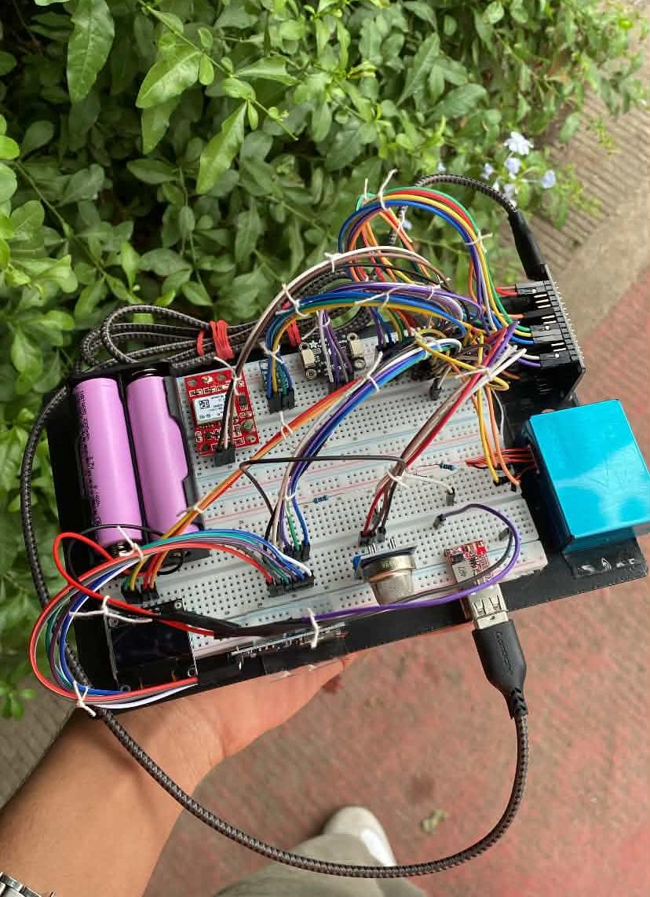
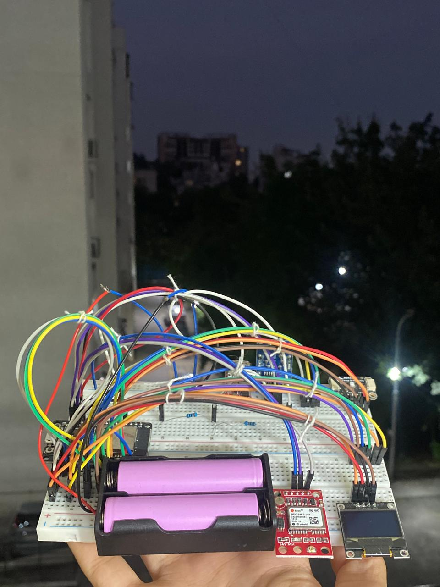
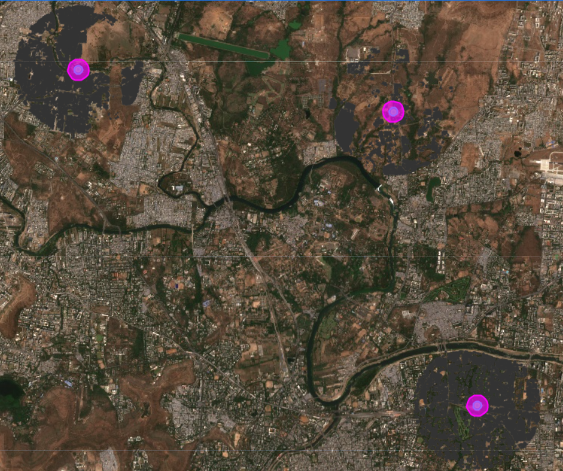
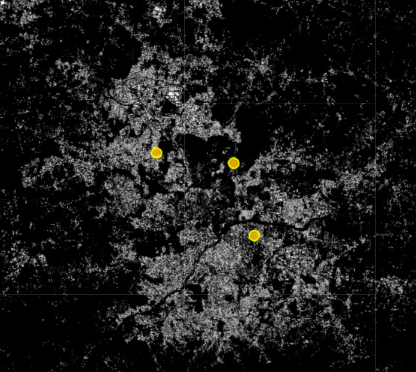
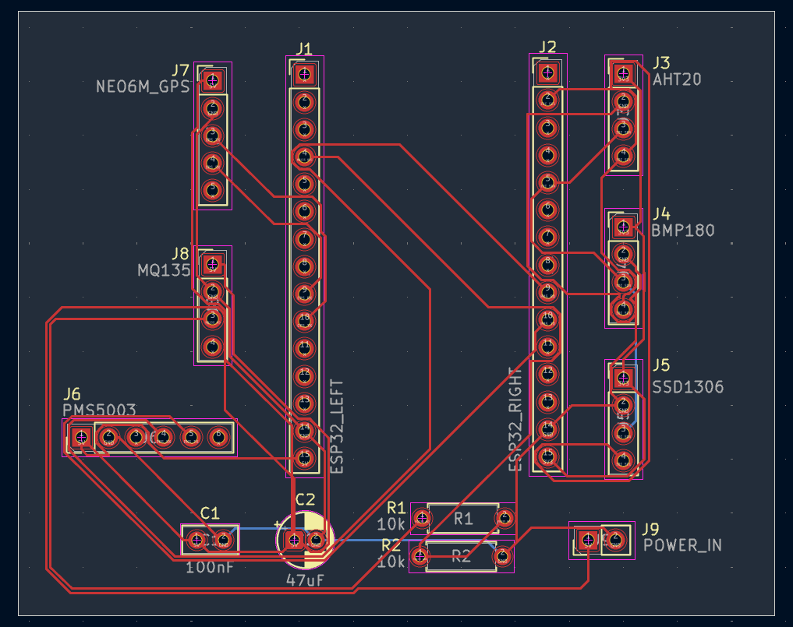
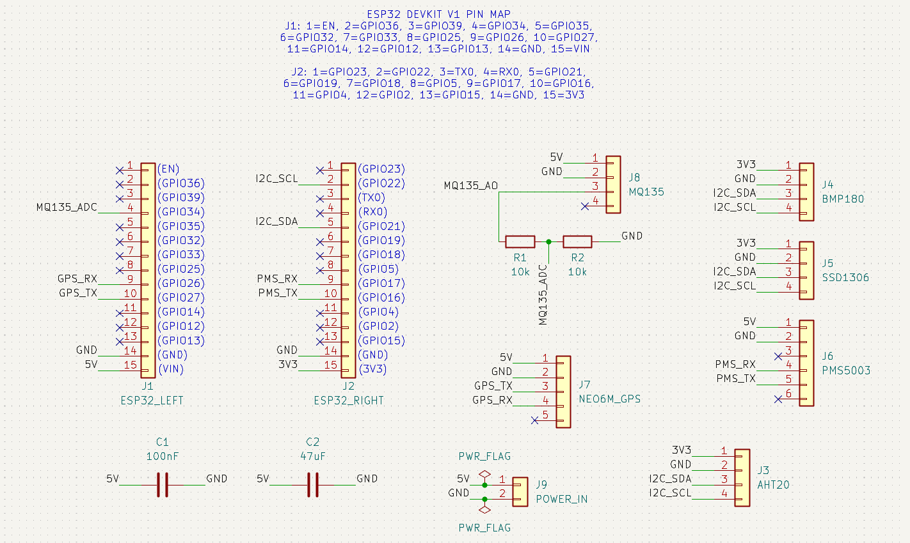

  

<h1 align="center">Zephyr</h1>

  <strong>Satellite Assisted Hyperlocal Air Quality Reconstruction</strong>

  An environmental monitoring and research project combining ground level sensor data with satellite observations to investigate and reconstruct hyperlocal PM2.5 pollution patterns.

  
  
  
  

---

Can a sparse network of low cost ground sensors, fused with freely available satellite aerosol data, reconstruct accurate hyperlocal (street by street) air pollution levels — outperforming both "nearest official station" estimates and ground sensors alone? 

[<video src="https://githubusercontent.com" controls autoplay muted loop width="100%"></video>](https://github.com/user-attachments/assets/357be0b4-d9a9-4513-a550-b56602abb73d)

---

## Overview 

Zephyr collects ground level particulate matter and environmental readings to support research into estimating PM2.5 pollution in areas with sparse monitoring coverage. Zephyr aims to address the challenges of urban air pollution by making hyperlocal air quality insights more accessible and actionable. By combining ground level sensor measurements with satellite derived data, the project seeks to identify pollution patterns that conventional monitoring networks may overlook. 

<table>
  <tr>
    <td align="center">
      
    </td>
    <td align="center">
      
    </td>
  </tr>
</table>

---

## Research Workflow

> **Detailed Research Journal:** For the complete development history, experimental logs, methodology, and progress documentation, refer to the [Zephyr Research Journal](https://docs.google.com/document/d/1UNnaVMcwHacSM3fK-nPlUQ8PDllBp77jAxlY4db8Qwo/edit?tab=t.0).

Zephyr investigates **satellite assisted reconstruction of hyperlocal PM2.5 concentration fields** by integrating sparse ground level observations from CPCB Continuous Ambient Air Quality Monitoring Stations (CAAQMS) with satellite derived atmospheric data from Sentinel-5P.

The workflow encompasses geospatial preprocessing, spatiotemporal data alignment, ground-station coverage analysis, meteorological feature integration, and diffusion based reconstruction of urban pollution fields. Model evaluation focuses on spatial generalization and quantitative validation against suitable ground-level reference measurements, using metrics such as MAE, RMSE, and \(R^2\).

The objective is to investigate whether multi source data fusion can improve the spatial resolution of air quality estimates in areas underserved by conventional monitoring networks.

<table>
  <tr>
    <td align="center">
      
    </td>
    <td align="center">
      
    </td>
  </tr>
</table>

---

## PCB and Hardware

Zephyr integrates **embedded systems engineering and environmental sensing** into a portable air quality monitoring platform built around the ESP32. The system combines particulate matter, meteorological, gas sensing, and GPS modules for localized environmental data acquisition.

The custom PCB design process uses **KiCad based electronic design automation (EDA)**, incorporating schematic capture, component layout, power distribution, and design rule verification. Firmware driven sensor interfacing and microSD based CSV logging support field data collection for subsequent geospatial analysis.

### Core Components

- **ESP32:** Embedded processing and sensor interfacing.
- **PMS5003:** PM1.0, PM2.5, and PM10 measurements.
- **AHT20 + BMP180:** Temperature, humidity, and atmospheric pressure.
- **MQ135:** Analog gas sensor readings.
- **GPS + microSD:** Geospatial tagging and local data logging.
- **Battery and voltage regulation:** Portable power delivery.

  

  

